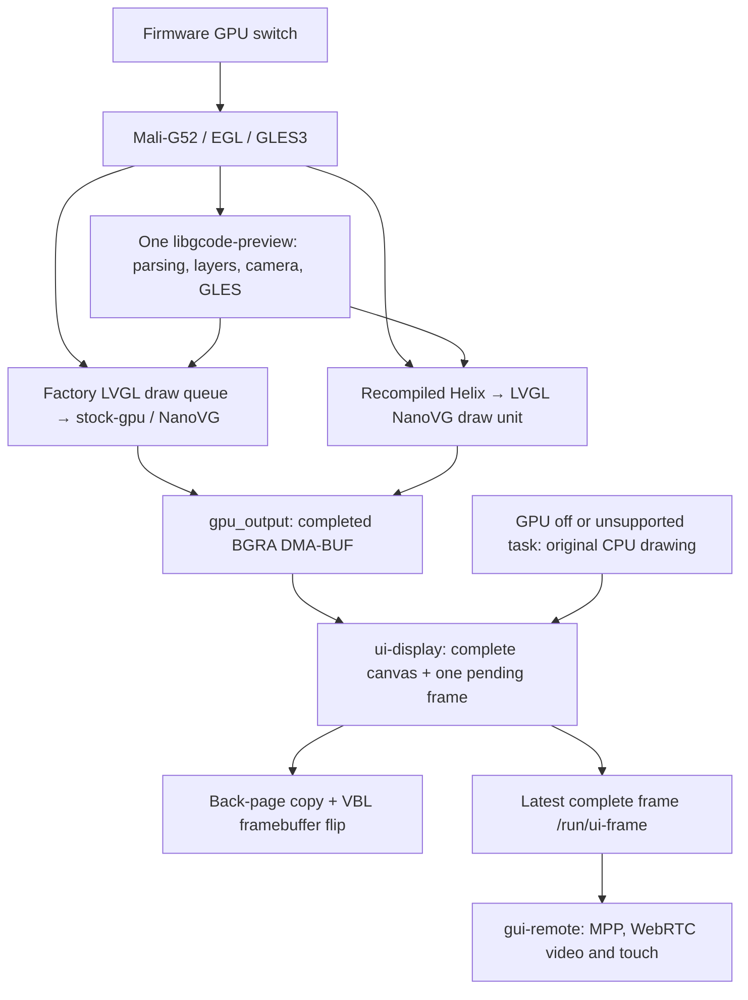

# GPU and display architecture

Updated 2026-11-04. `gpu` owns GPU startup, native widget drawing, one shared G-code renderer and complete-frame presentation. The factory UI remains primary. Its layout, application state and input handling stay in the original executable. Helix retains its upstream application and uses the same G-code library.

## Rendering and presentation

The new widget routes execute fills, glyph compositing, images and layers on the GPU. They replace CPU display rasterization. Font decoding, layout and application logic remain on the CPU. The factory UI also prepares small canvas assets on worker threads; those are counted separately from display drawing.

`stock-display` is the sole factory main-loop hook. After installing the presenter it optionally loads `libstock-gpu.so` and calls `stock_gpu_tick`. The adapter checks the exact 2.1.0.157 executable hash, draw-unit ownership, buffer geometry and format before changing the display draw queue. Unknown executables bypass private calls. The older 2.0 adapter only retains its previously verified timer change; it is not a supported native GPU target.

Helix is pinned to 1.0.7 / `faed4e35010e970ba5612e9b2e109c52a11965a6` and its LVGL submodule. The U1 build uses fbdev and LVGL's NanoVG GLES3 draw unit. Patches fix font bitmap stride, layer ownership/clearing, opacity and clipping, and batch glyphs in an A8 atlas. Other platforms retain upstream renderer selection. `ENABLE_OPENGLES=no` disables Helix's separate display backend; it does not disable the U1 NanoVG draw unit.

Both routes retain dirty regions in a GPU framebuffer. Their last LVGL flush waits for completed GPU work, copies the image and submits one complete frame. An unsupported display task rejects the incomplete frame, restores software drawing and invalidates the full screen. Recovery is sticky until UI restart. `/tmp/ui-renderer.json` includes PID, renderer, GPU and CPU display counts, rejected frames and reason. A stale report from another PID is not evidence about the running UI.

## Shared G-code and output

`libgcode-preview.so` exports `gcode_preview_get_api(1)`. The factory adapter in `72-stock-ui` and the U1 Helix widget use this versioned C API. The library owns parsing, file identity, current-layer following, cameras, geometry, supersampling and rendering. Both UIs display the same native palette, opaque selected layer, translucent surrounding layers and estimated time.

Its EGL worker opens `renderD128` without taking display ownership. Callers request a source and view, then poll the latest complete image. Generation checks discard obsolete results. A parsed model is not a displayed first frame. Helix retains its thumbnail until a complete frame arrives, invalidates image caches after mutable pixel updates and before freeing image buffers, and uses the shared fullscreen controls. Manual layer selection cancels following. There is no independent U1 Helix parser or camera implementation to maintain.

`gpu_output` owns linear DMA-BUF allocation, EGL import and CPU read synchronization. It supports RGBA G-code output and BGRA widget output. G-code retains `glReadPixels` when import is unavailable; widget renderer initialization failure retains software drawing. CPU copies into LVGL and fbdev remain. This is not direct GPU scanout or an end-to-end zero-copy pipeline.

## Cadence, scanout and remote control

The supported UIs use 22 ms display, animation and input polling periods with GPU either on or off. The panel's measured mode is about 45 Hz. No 60/120 Hz panel mode has been verified. More render submissions cannot increase the physical panel's refresh rate.

`ui-display` accumulates partial flushes into a complete 480×320 canvas. A worker handles the blocking presentation call while the UI prepares its next frame. One replaceable pending frame bounds memory and latency. The worker sleeps when idle and drains the latest pending frame before closing. This benefit is independent of GPU rendering. `UI_DISPLAY_SYNC=1` retains the synchronous path for a controlled comparison.

Boot configuration requests two fbdev pages with `drm_kms_helper.drm_fbdev_overalloc=200`. The presenter copies to the back page and uses `FBIOPAN_DISPLAY` with `FB_ACTIVATE_VBL`. The pinned Rockchip driver performs a blocking atomic commit. A failed flip retains the previous complete page; the next submission uses the latest complete canvas. Only EINTR retries the same flip, with three total attempts. Single-page fallback is unsynchronized compatibility operation, not a tearing fix.

`/tmp/ui-display.json` records asynchronous mode, submissions, coalescing, flips and errors. Acceptance also checks the active DRM CRTC and plane, then compares the selected physical framebuffer page with the completed snapshot. This verifies frame consistency, not the absence of visible tearing in motion. Panel activation can produce transient EBUSY during UI changes; steady-state error deltas are recorded separately.

After presentation, the worker publishes to `/run/ui-frame` using `common/ui-frame.h`: dimensions, stride, sequence, monotonic timestamp, producer PID and XRGB8888 pixels. Nonblocking locks prevent capture from stalling the UI. The remote source is a completed UI canvas, including when the panel sleeps; its timestamp is not proof of physical scanout. `gui-remote` owns MPP encoding, WebRTC sessions and touch. MPP works independently of Mali. Ordered reliable touch edges and latest-only move messages use separate DataChannels.

## Evidence and limits

These are measurements of this hardware, not throughput promises.

Actions [41750021041](https://github.com/BICHENG/SnapmakerU1-Extended-Firmware/actions/runs/41750021041)
built `stock-ui-47b1325`. The printer downloaded and verified the artifact,
installed slot B, and passed real-page, shared-preview and WebRTC interaction
checks. The factory executable, kernel and MCU payloads are unchanged. The
patched Helix executable is identical in the driver-on and driver-off tests.

Corrected exact-image menu tests use two 12-second gestures per condition,
discard the first 0.5 seconds, retain endpoint pauses, and have 100% sequence
coverage with no new flip errors:

| UI | GPU off, completed frames/s | GPU on, completed frames/s | Result |
| --- | --- | --- | --- |
| Factory Settings | 44.83–44.91 | 43.43–43.60 | GPU is slightly slower in this workload |
| Helix Settings | 42.21–42.56 | 42.91–43.00 | Small difference; no established speedup |

These timestamps measure completed canvases with an active panel, not
input-to-photon latency. GPU mode costs more GUI CPU in both tests. It enables
native widget drawing and the shared real-time G-code path; it does not make
ordinary menus intrinsically cheaper. The 22 ms policy and asynchronous
complete-frame presenter remain available with GPU disabled.

The same fullscreen G-code gesture measured 20.28 fps in the factory UI and
20.05 fps in Helix (one run each, 157-layer file, 2× linear supersampling,
100% sequence coverage, no new flip errors). P95 complete-frame gaps were
71.03/66.74 ms. Both adapters update the actual geometry and prevent the
embedded widget from being scrolled offscreen. File estimates are displayed;
live-print layer following and changing remaining-time estimates still need
a real-print soak. No print, heater or motion command was sent by acceptance.

Two actual WebRTC viewers remained usable through six reloads for each UI;
reconnections took 0.91–1.11 s. Actual browser clicks and drags used the two
DataChannels and the selected media/data candidate was the printer's Tailscale
address. The test page itself loaded through an SSH HTTP forward. These tests
establish session cleanup and control, not a bound on WAN input-to-photon latency.

| Comparison | Observed result | Interpretation |
| --- | --- | --- |
| Historical factory input polling 33 → 22 ms, before GPU widget drawing | Menu gesture 29.48 → 43.52 fps; both raw runs have zero missing sequences and active scanout | Scheduling improvement independent of GPU; older firmware evidence |
| Native widget rendering, matched asynchronous lab runs | CPU median 6.68 ms; GPU 11.19 ms | GPU takeover is real; rasterization is currently more expensive |
| Helix Settings, same binary and page | CPU median 5.34 ms; GPU 9.94 ms | No widget render-speed gain |
| Native GPU display + shared G-code | Complete physical frame matches snapshot; rotated geometry changes; 0 CPU display tasks | Real display drawing and live preview coexist |
| Forced unsupported task, native and Helix lab runs | Incomplete frame rejected; software redraw restored; recovery pixel comparison passed | Fallback is tested, not just configured |

Several earlier menu comparisons used a sampler that polled `FBIOGET_VSCREENINFO` before reading the snapshot. It missed varying numbers of completed frames in the native-GPU candidate and first release runs; their FPS and long-gap comparisons are withdrawn. The historical 33/22 ms pair above was separately rechecked and had no missing sequences. A corrected sampler polls snapshot headers without framebuffer ioctls, uses an unlocked peek only as a scheduling hint, then validates each new header under a short read lock. Each run reports sequence coverage. Unconditional read-lock polling also causes publication skips because the presenter never waits on capture. Component render timings above come from in-process instrumentation and are separate from this observer.

Page tests include fonts, images, transparency, nested layers, dialogs, Settings and file detail. They do not prove every possible vendor page or Helix plugin is supported. Unknown tasks recover to CPU. Current GPU cost includes submission, GPU completion and output delivery; neither average FPS nor a loaded Mali driver establishes acceleration. The previous exact-pixel CPU-command compositor was slower and is not installed.

Keep `UI_DISPLAY_BASELINE=1` for the old 33 ms/no-presenter path. It changes multiple factors. Use `UI_DISPLAY_SYNC=1` to isolate presentation scheduling, and GPU on/off with the same cadence and binary to isolate widget rendering. The Firmware switch also changes G-code availability; do not use it to isolate G-code DMA delivery. Use `UI_GPU_OUTPUT=readback` for that comparison.

## Build and maintenance

The existing feature firmware workflow builds pinned Helix, verifies its source manifest and stripped AArch64 binary, then builds firmware. Cache keys include renderer sources, vendor patches, shared headers/output, the workflow and packaging script. Missing, stale, oversized or changed artifacts fail the build. Native NanoVG sources are fetched at the pinned LVGL commit and shipped with their licences.

Maintain these capabilities in `gpu`; integrate `gpu` and `gui-remote` into `gui`, then `gui` into `stock-ui`. `gui-gcode` and `gui-gpu` are historical experiments, not intermediate release branches. Factory recreation remains a conditional fallback; native drawing now works without replacing the UX.

The Firmware page exposes one GPU switch. Keep atlas sizes, EGL choices, frame periods and diagnostics internal. Preserve the checked 400 MHz cap, voltage table, panel timings, UI selection and software recovery. Changes to these boundaries require device measurements, not additional user tuning knobs.
