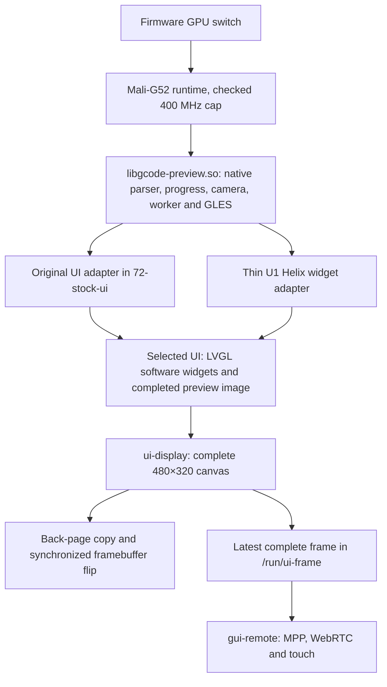

# GPU and display architecture

Updated 2026-11-03. `gpu` maintains the GPU runtime, one native G-code library
used by the original UI and Helix, and their display adapters. `gui-gcode` is a
historical branch. The original UI remains primary; the Firmware GPU switch
preserves the selected interface.

The final Helix executable links successfully, 26 startup/hook tests pass on
Linux, and the device EGL smoke check through `renderD128` reports Mali-G52 with
no GL error. The final firmware's two-page boot configuration and both UIs'
physical-panel behavior still require flash acceptance. No new tearing or
frame-rate result is claimed here.

## Rendering and presentation

The GPU accelerates G-code drawing. Ordinary widgets in both interfaces still
use LVGL's software renderer. Widget cadence and complete-frame presentation
work independently of GPU availability. The common library opens
`/dev/dri/renderD128` for GBM/EGL and does not acquire primary display ownership.
The existing voltage table and panel timings are preserved; startup sets and
checks a 400 MHz GPU maximum.

### One G-code library

`71-ui-gpu/apps/gcode-preview` installs `/usr/local/lib/libgcode-preview.so`.
Both adapters request `gcode_preview_get_api(1)`. Helix also checks the returned
ABI version and table size. The library owns the original implementation's parsing, current-job
progress, cameras, layer selection, supersampled rendering and native palette.
Its EGL worker produces the latest complete image. Generation checks discard
old results when the source changes. UI callers poll without waiting for GL and
draw only completed images. A loaded model and a first rendered frame are
distinct events, including while a widget is paused.

The U1 Helix build keeps fbdev and sets `ENABLE_GLES_3D=no` and
`ENABLE_OPENGLES=no`. Its widget adapter replaces the old U1 parser/camera/GLES
path rather than extending it. Other Helix platforms retain upstream source
selection. GPU off selects the normal thumbnail and does not load the shared
GPU preview. Matching Helix assets are required for the patched executable;
mismatches select the official executable.

The adapter supplies the exact known job filename with its local cache path.
Both interfaces therefore use the native engine's live layer and file-progress
rules. Fullscreen controls use the native camera increments and current-layer
selection. Helix keeps its own page and loading lifecycle and shows the preview
only after a completed frame. Unsupported palette overrides and preview object
picking are disabled. Existing host preflight scans and explicit object-list
controls remain separate from the preview.

`apps/ui-gpu/gpu_output.c` is compiled into this single library. It owns DMA-BUF
allocation, EGL import and CPU read synchronization. Failed imports retain
`glReadPixels`; failed synchronization aborts a frame. Copies into LVGL and
fbdev remain. There is no extra graphics service or end-to-end zero-copy claim.

### Local display

`ui-display` accumulates partial LVGL flushes into a full CPU canvas and presents
only at the last flush. Boot configuration requests two fbdev pages with
`drm_kms_helper.drm_fbdev_overalloc=200`. When geometry and page availability
pass validation, the presenter copies to the back page and calls
`FBIOPAN_DISPLAY` with `FB_ACTIVATE_VBL`. The pinned Rockchip fbdev driver uses
a blocking atomic commit, so page reuse follows completion. If a two-page flip
fails, the previous complete page remains visible and the next flush submits
the complete retained canvas. Only `EINTR` is retried on the same back page,
with at most three total attempts. When only one page is available, visible-page
copying remains as an unsynchronized compatibility mode.

`/tmp/ui-display.json` records page availability, flips, errors, the last failure,
yoffset, publish skips and maximum flip duration. Physical-panel acceptance
requires two pages, successful flips and `/sys/kernel/debug/dri/0/state` showing
the target CRTC with `enable=1 active=1` and a nonzero framebuffer on its plane.
`bl_power=0` and increasing flip counts do not prove active scanout. The current
panel mode was measured at about 45 Hz; no 60/120 Hz mode has been verified.

The supported 2.1 original UI and patched Helix use 22 ms display, animation
and input polling periods independently of the Firmware GPU switch.
These are scheduling periods, not measurements of unique preview
frames or touch latency. The original adapter recognizes exact hashes for
2.0.0.205 and 2.1.0.157. The new presenter, animation timer and performance events
are verified for the 2.1 adapter. The 2.0 adapter changes only its verified
display timer. Unknown binaries bypass private calls. `stock-display` owns the
sole original sleep hook and calls the optional G-code adapter's `stock_ui_tick`.

Real Settings-menu dragging on 2026-11-03 exposed a missing original input
timer adjustment: the display and animation timers were 22 ms, but pointer
polling remained 33 ms. The same local gesture measured 29.48 fps with that
mismatch and 43.52 fps after aligning input, with frame-interval P95 improving
from 44.61 to 22.78 ms. Both runs had an active panel and no new flip errors.
GPU active time did not increase. Occasional longer frames remain; forced
homepage throughput is not a substitute for this interaction measurement.

### Remote source ABI

`common/ui-frame.h` defines `/run/ui-frame`: a 64-byte header with dimensions,
stride, sequence, monotonic timestamp and producer PID, followed by one
480×320 XRGB8888 image. The presenter publishes complete canvases under
nonblocking POSIX record locks. A lifetime producer lock prevents competing UI
producers. A busy reader causes a skipped publication; it does not stall local
presentation. No historical frame queue accumulates.

`gui-remote` consumes this ABI and validates the producer and layout before
encoding. Unchanged frames can be skipped while retaining keyframe and idle
heartbeat behavior. The source timestamp identifies a completed UI canvas and
presentation attempt, not physical scanout; the canvas is still published while
the panel sleeps. Encoder timestamps describe capture after the snapshot copy.
Older firmware can fall back to the framebuffer's visible yoffset, without the
complete-frame guarantee. MPP is a separate hardware engine and works with
Mali disabled. Encoding, WebRTC session lifetime and remote touch remain outside
the `gpu` branch's display ownership.

## Previous-release measurements

These results predate the shared-library adapter and new complete-frame
presenter. They establish earlier costs and the reason for separating refresh
policy from GPU availability. They are not acceptance results for this build.

| Previous comparison | Result | Limit |
| --- | --- | --- |
| Native 70,370-vertex sample, readback versus DMA-BUF output, ABBA | Mean of run medians 39.31 → 28.69 ms | About 27% lower render/delivery time for that sample and geometry |
| Retired independent Helix renderer, complex model | 65.75 ms at 480×320; 46.31 ms at 317×193 | Different viewport costs; neither is the new shared-library baseline |
| Original homepage, GPU driver absent, 33/22 ms periods | 30.15 / 45.15 fps | CPU widget cadence alone reached about 45 completed renders/s |
| Same homepage test, GPU driver present, 33/22 ms periods | 30.20 / 45.20 fps | GPU availability added no material widget frame-rate benefit |

The 2026-11-01 homepage ablation used two sessions and four complete five-second
windows per group. The disabled group rebooted without the GPU module or device
node. GPU active-time counters did not increase during the enabled sessions.
Temperature and connection indicators varied across boots, so GUI CPU-use
differences cannot be attributed to the driver alone. The test forced bounded
full-page redraw. It did not measure natural animation, touch latency or panel
scanout. Renderer details remain in
[BENCHMARK.md](../overlays/mods/BICHENG/71-ui-gpu/apps/gcode-preview/BENCHMARK.md).

The current code decouples the 22 ms policy from the GPU switch. This follows the
earlier ablation but needs new measurements with the presenter enabled. Complex
G-code may still exceed the panel's roughly 22.2 ms frame budget.

`UI_DISPLAY_BASELINE=1` selects 33 ms periods and bypasses the new presenter.
It compares the previous display path, changing both scheduling and presentation.
To isolate either factor, hold the other fixed. Renderer comparisons must also
hold source, viewport, geometry, quality and observers fixed. Use
`UI_GPU_OUTPUT=readback` versus automatic output in the same GPU-enabled library
to isolate output delivery. The Firmware switch changes G-code availability
and is not an output-path benchmark.

## Maintenance boundary

Maintain runtime correctness, the shared library and its two thin adapters in
`gpu`. Preserve the checked frequency cap, voltage table, runtime suspend,
selected UI, software widgets and setting keys. Keep all G-code parsing and
render behavior in the shared library. Do not restore an independent Helix
renderer or infer deployment success from a branch merge or build result.

| Changed layer | Required verification |
| --- | --- |
| Startup, setting or Helix selection | `71-ui-gpu/test/test_*.py`; matching-asset and fallback checks |
| Display presenter and original adapter | Host sanitizer tests, exact GUI hashes, actual two-page boot, flip counters and both physical UIs |
| Shared G-code library | Parser/progress/runtime tests, target build, pixels, source changes, pause/resume and lifetime checks |
| U1 Helix adapter | Source selection, API coverage, loading/first-frame/clear behavior, fullscreen and thumbnail fallback |
| GPU output or driver | Target imports/readback, synchronization, cleanup and idle suspend; both consumers |
| Remote source ABI | Producer/reader locking, complete-frame publication, sequence handling and framebuffer fallback |

Update upstream through `gpu`, then integrate `gpu` and `gui-remote` into `gui`,
and `gui` into `stock-ui`. Other product features remain independent.
`gui-gcode` is no longer an intermediate build or merge target. Preserve
published history; opening a PR remains a separate user decision.

`gui-gpu` holds optional factory-widget drawing and automated reconstruction
research. The earlier exact-pixel widget compositor was slower than CPU and is
not installed in daily firmware. Further work needs a measured expensive page,
complete-frame gains, bounded resources and software fallback before integration.
