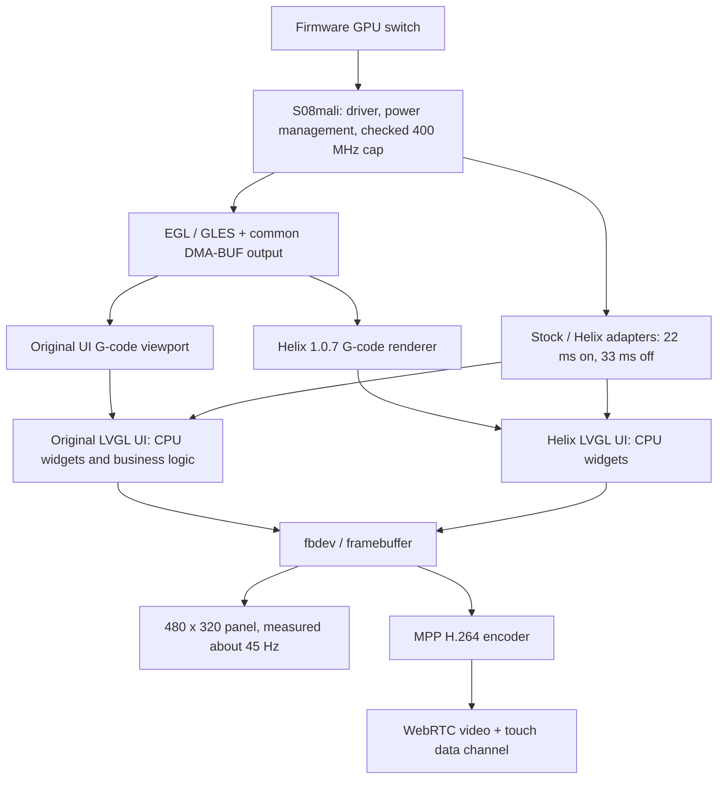

# GPU architecture and UI reconstruction boundary

Updated 2026-11-01. The daily runtime was accepted in stock-ui commit 7ba72da on vendor 2.1.0.157. The GPU foundation is gpu and is now in maintenance. gui-gpu holds factory drawing experiments and automatic reconstruction research. The last runtime change, 81e9729, corrects only the bounded repaint measurement. The maintenance decision changes no runtime code.

## Maintenance boundary

This section owns the gpu maintenance rules. Keep the existing driver and power policy, shared output, Firmware switch, factory/Helix adapters and bounded measurements. Accept correctness and compatibility fixes, resource-lifetime fixes and verified upstream updates. New page behavior, printer commands and the experimental widget renderer stay outside this branch. A new backend needs a measured problem in a specific page and a complete-frame benefit before reconsideration.

Keep the deployed defaults: opt-in GPU, checked 400 MHz cap, runtime suspend, original software widgets, 22 ms enabled cadence and the 33 ms disabled baseline. Preserve installed paths and configuration keys. Unknown factory executables must pass through without private calls; mismatched Helix assets must use the official executable. Unsupported DMA imports retain readback, while failed CPU synchronization must abort the frame. Maintenance does not add a service, renderer switch or panel overclock.

Choose the comparison that answers the change:

| Question | Hold fixed | Change and report |
| --- | --- | --- |
| Does a renderer help? | Same page/state, display and animation periods, resolution, visual quality and observers | CPU/GPU drawing only; complete-frame time, memory and pixels. Use an isolated experiment; the Firmware off/on switch is not this comparison. |
| Does shared output help? | Same GLES binary, geometry, cadence and visual quality | UI_GPU_OUTPUT=readback versus automatic output; include completion, synchronization and delivery. |
| What does the user-facing switch do? | Same page/workload and measurement window | Existing off/on policy; identify both GPU availability and 33/22 ms cadence changes. Do not attribute the frame-rate difference to GPU widget drawing. |

Use the checks already attached to the changed layer:

| Changed layer | Existing verification |
| --- | --- |
| Startup, setting or Helix selection | test/test_*.py through the Feature firmware workflow |
| Factory display adapter | apps/stock-display make test with ASan/UBSan; target checks for exact GUI-hash handling, native timer cadence and expiry of bounded redraw requests |
| Shared output or driver | Target build plus existing offscreen pixel, import/readback, resource-lifetime and suspend checks while idle |
| Helix pin or build inputs | prepare-helix-gpu.py source/checksum verification, matching assets and the production-object self-test |
| Documentation only | Diff, links and branch ancestry; retain the successful runtime build record without another firmware build or device test |

Follow upstream through gpu, then gui-gcode, gui and stock-ui; gui-gpu follows gpu separately and stays outside daily integration. Preserve published history. Source updates that touch a consumer require that consumer's checks; build success alone does not establish device acceptance. Keep the build commit, current documentation head and deployed firmware distinct. Opening a PR remains a separate user decision.

## What runs today

gpu owns three bounded parts:

| Part | Responsibility | Boundary |
| --- | --- | --- |
| Hardware/runtime | Existing RK3562 Mali-G52 node, pinned driver and userspace library, runtime suspend, effective policy after checking the 400 MHz cap | No voltage change, panel overclock or additional graphics daemon |
| Shared output | Allocate DMA-BUF, import it into EGL, expose a texture, wait for GPU completion, pair CPU read synchronization and release resources | No page logic, geometry, font layout or printer commands |
| Consumer adapters | Exact-hash factory refresh/measurement adapter; version-matched Helix executable with shared output and bounded geometry | Private factory ABI stays separate from the reusable module |

The implementation remains under overlays/mods/BICHENG/71-ui-gpu. Renaming a Git branch does not rename installed files, configuration keys or service hooks. The existing Firmware switch remains **Firmware → Snapmaker components → Touchscreen GPU acceleration**. It preserves the selected UI and applies by reboot while idle with heater targets at zero.

The output API is deliberately small: create an output, obtain its texture and stride, begin/end a CPU read, then destroy it. The caller owns its EGL context, geometry, orientation and color conversion. Normal output uses DMA-BUF instead of glReadPixels; failed imports retain the existing readback path. GPU completion and CPU cache synchronization are both required. The final copy into LVGL/fbdev still exists, so this is not an end-to-end zero-copy pipeline.

Helix consumes the same source without user renderer adjustments. Its U1 geometry path limits tube sides to four, omits degenerate triangles, writes selection tags in the main pass and checks a combined geometry/GPU memory budget before allocation. An over-budget model retains the existing 2D fallback. Its normal labels, buttons and lists still use CPU rendering.

gui-remote owns framebuffer capture, MPP video encoding, WebRTC and touch lifecycle. MPP is a different hardware block from Mali, so remote operation remains available with GPU disabled. gui-gcode owns parsing, current-layer display, progress, viewport controls and the original UI entry point. These responsibilities do not belong in the common output module.

## What the measurements establish

| Measurement | Accepted result | Interpretation |
| --- | --- | --- |
| Original homepage, corrected bounded repaint, GPU setting on | 45.0 / 45.2 complete frames/s; refresh p95 6.81 / 6.85 ms | Current CPU-widget page follows the configured 22 ms cadence; not every page or panel scanout |
| Isolated original timer handler, setting off/on | 30.18 / 45.28 drawn frames/s | 33 / 22 ms policy; independent 7 / 37 ms timers retain identical callback counts |
| Same 70,370-vertex G-code sample, readback/shared output, ABBA | Mean of run medians 39.31 → 28.69 ms | About 27% lower renderer/delivery time for this sample |
| Helix complex model, shared output | 65.75 ms at 480×320; 46.31 ms at 317×193 | Roughly 15–22 complete redraws/s for this model, not a universal high-frame-rate claim |
| Read-only WebRTC, both switch states | About 45 decoded frames/s, no drops in the measured five-second intervals | Video frame rate differs from newly rendered UI frames |

The panel mode is about 45 Hz. There is no verified 60/120 Hz mode. A 22.2 ms frame budget is the relevant current target; idle screens should stop drawing. No long-print or acoustic acceptance follows from these short measurements.

The earlier 28.3/39.1 forced-repaint result was limited by a second clock in the benchmark. Its refresh counters already showed about 30.2/45.2 opportunities per second, but some cycles were not invalidated. The correction keeps the page dirty during the explicit 1–15 second test and leaves cadence to the original timer. It is a measurement fix, not additional GPU or animation acceleration. Normal idle behavior is unchanged.

## Why a GPU switch does not convert every widget

The factory executable contains a statically linked LVGL 9.2-derived implementation and a software draw unit. Loading EGL or changing a display driver does not replace its widget rasterizer. Helix 1.0.7 also keeps CPU widgets in the shipped configuration.

A GPU copy of an already CPU-rendered frame does not remove the CPU drawing work. Conversely, moving each tiny rectangle to GPU and synchronizing after it can cost more. Existing isolated experiments measured a full-screen CPU fill around 0.24 ms versus about 1.18 ms for GPU drawing plus completion on a shared buffer. These are primitive tests, not complete page timings, but they reject a blanket per-widget conversion.

The gui-gpu experiment now verifies exact GPU pixels in fifteen synthetic default-font scenes, using an ordered batch, 1,920-byte BGRA DMA buffers and framebuffer fetch for the original integer alpha semantics. The 204-glyph scene is still slower on GPU: 2.37 ms versus 1.37 ms through native CPU drawing and delivery. Atlas preparation is outside the warm GPU timing, while native CPU timing includes label layout. This candidate is rejected for daily use.

The original homepage capture has seven fills, twelve labels and twelve images. Its measured CPU path fits the current panel budget, so retain the original application and widgets. Future GPU drawing work requires a measured expensive page and complete-frame benefit, including DIRECT copies, mixed CPU/GPU ownership and fbdev delivery. The shared-output helper alone does not replace these responsibilities. Native task descriptors must remain alive until drawing completes.

## Automatic reconstruction: evidence and limits

The current versioned capture verifies the original homepage's frame and 31 drawing tasks without replacing dispatch. Eight isolated glyph/image cases verify owned resource copies and native replay after source assets are overwritten, including capacity failures that preserve original drawing. Those resource routines are not connected to the live capture. Replay still calls the original ELF's CPU drawing functions; it is not an independent UI or renderer.

If a separate UI is required, its automation must capture versioned assets and states, generate views, then replay the same inputs and printer-status events through original and generated implementations. Compare images, focus, modal state, navigation and outgoing commands. Unsupported states must remain explicit gaps. Unknown CAN/GPIO behavior cannot be inferred from screenshots or replaced with guessed Moonraker calls. Do not run two independent printer controllers simultaneously.

For a source-owned reconstruction, LVGL's current NanoVG draw unit is a candidate for actual GPU widget rendering. It is not a drop-in library replacement for the statically linked factory LVGL. Its documented stencil/MSAA requirements, layer readback and U1 driver compatibility require a pinned build and measurement. No backend has been selected for production yet. See [LVGL OpenGL overview](https://lvgl.io/docs/open/integration/embedded_linux/opengl) and [NanoVG draw unit](https://lvgl.io/docs/open/integration/embedded_linux/draw_units/draw_nanovg).

## Branch and promotion rules

gpu remains the reusable, accepted foundation. gui-gcode and the experimental gui-gpu follow it; gui-remote remains independent. Routine daily integration is gpu → gui-gcode → gui, plus gui-remote → gui, followed by gui and the other product features → stock-ui.

gui-gpu contains source-owned diagnostics, measured results and a disabled-by-default observation entry point in the existing main-loop adapter. The probe libraries are not packaged into firmware. Its separate checks run host sanitizer tests and target compilation; the existing firmware Actions remain sufficient for future accepted candidates. It enters daily integration only after representative pages and state replay show equivalent behavior, repeatable complete-frame gains, correct software fallback, bounded memory and idle resource release. See the [experimental results](https://github.com/BICHENG/SnapmakerU1-Extended-Firmware/tree/gui-gpu/tools/native-ui).
