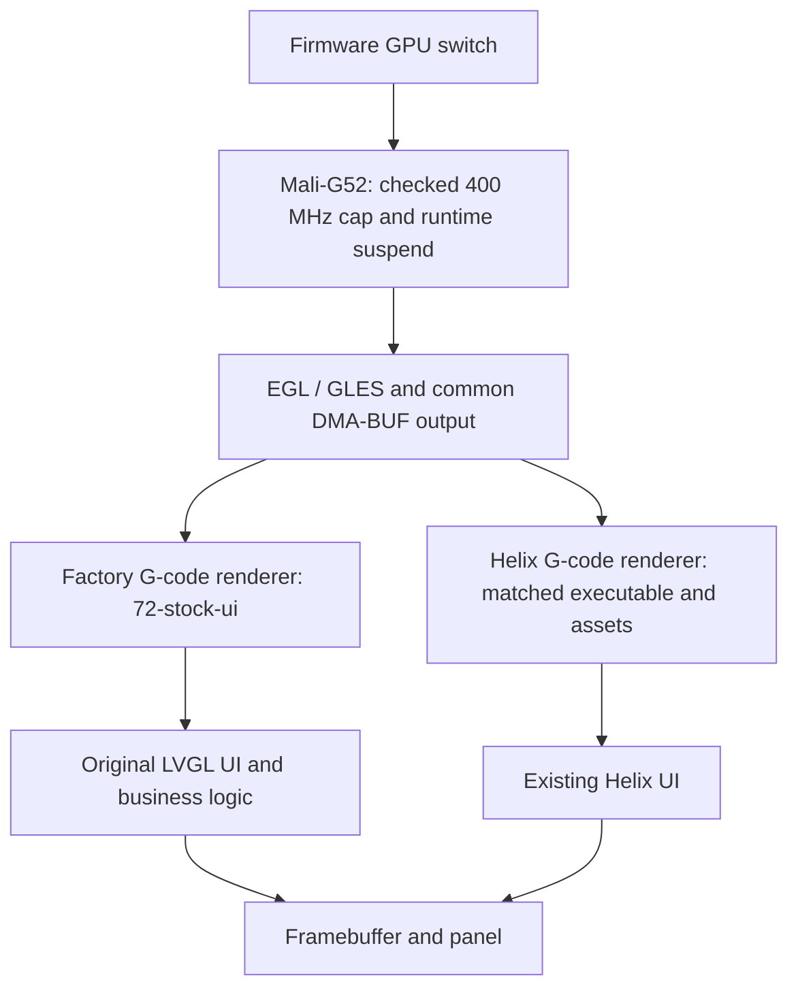

# GPU rendering architecture

Updated 2026-11-02. gpu is the maintained feature branch for GPU runtime, factory G-code rendering and Helix G-code adaptation. Helix adaptation was already present; the former gui-gcode implementation is now included through a history-preserving fast-forward. gui-gcode remains a historical reference. Consolidation changes ownership and build selection, not the existing rendering implementations.

## What the feature provides

| Part | User-visible result | Implementation owner |
| --- | --- | --- |
| GPU runtime and shared output | A checked GPU capability with bounded frequency, idle suspend and synchronized output | 71-ui-gpu driver/runtime and apps/ui-gpu |
| Factory G-code renderer | Live toolpaths inside the original printing UI, current-layer following, translucent context and an interactive supersampled preview | 72-stock-ui |
| Helix adaptation | Existing Helix G-code rendering uses the common output path and bounded U1 geometry without renderer tuning | 71-ui-gpu Helix patch and version-matched build |

The original UI remains primary. The Firmware switch preserves the selected interface; enabling GPU does not switch to Helix. Both interfaces retain CPU rendering for ordinary widgets.

The shared output module owns allocation, EGL import, texture, stride, completion, CPU read synchronization and cleanup. Each consumer owns geometry, orientation, color conversion and UI behavior. Failed imports retain glReadPixels; synchronization failure aborts the frame. Final copies into LVGL/fbdev remain. This is not an end-to-end zero-copy pipeline.

The factory adapter checks exact executable hashes before private calls. stock-display is the sole owner of the original sleep hook; it calls the G-code extension's stock_ui_tick. The parser/renderer worker never calls LVGL. Unsupported binaries keep the original application. Installed paths and the configuration keys remain unchanged.

Helix uses the same shared-output source through its existing GLES 2 renderer. Its U1 geometry path limits tube sides to four, omits degenerate triangles, writes selection tags in the main pass and checks a combined CPU/GPU memory budget before allocation. Over-budget models retain the existing 2D fallback. Mismatched assets select the official executable.

## Measured value and limits

| Comparison | Result | What it establishes |
| --- | --- | --- |
| Same 70,370-vertex factory G-code sample, readback versus shared output, ABBA | Mean of run medians 39.31 -> 28.69 ms | About 27% lower renderer/delivery time for this sample; same GPU geometry and quality |
| Helix complex model with shared output | 65.75 ms at 480x320; 46.31 ms at 317x193 | Measured complete redraw costs; these different view sizes are not a before/after improvement claim |
| Factory homepage, GPU driver absent, 33/22 ms periods | 30.15 / 45.15 fps | The native CPU page reaches about 45 fps through refresh policy alone |
| Same homepage test, GPU driver present, 33/22 ms periods | 30.20 / 45.20 fps | No material additional frame-rate benefit from making GPU available |

The 2026-11-01 homepage ablation used two sessions and four complete five-second windows per group. The disabled group rebooted with no GPU module or device node. GPU active-time counters did not increase during any of the four enabled sessions. Temperature/connection indicators varied across boots, so GUI CPU-use differences cannot be attributed to the driver alone. This is bounded full-page redraw, not natural-animation, touch-latency or panel-scanout measurement.

The current panel mode is about 45 Hz; no 60/120 Hz mode has been verified. Complex G-code can exceed its 22.2 ms budget. The factory renderer benchmark in 72-stock-ui/apps/stock-ui/BENCHMARK.md records output-path measurements on GPU-bearing branches. These checks do not establish long-print stability or acoustic effects.

The current Firmware setting still couples GPU availability and 33/22 ms widget cadence. That policy should be decoupled, because the native homepage gain does not require GPU. This consolidation leaves the default behavior intact. The earlier duplicate-clock fix only corrected the bounded redraw test; it did not accelerate normal widget drawing.

## Maintenance boundary

This section owns maintenance rules for the combined gpu feature. Maintain runtime correctness, compatibility, resource lifetime and both G-code consumers together. Keep their source modules separate. A change to a consumer must carry that consumer's checks; a branch merge alone is not a new performance result.

Preserve the checked 400 MHz cap, existing voltage table, runtime suspend, selected UI, software widgets, configuration keys and installed paths. Unknown factory executables must pass through without private calls. Mismatched Helix assets use the official executable. Import failures retain readback; failed CPU synchronization aborts the frame. Do not add a graphics service or panel overclock.

Refresh policy and GPU rendering are separate comparisons. Hold cadence, page/state, geometry, resolution, visual quality and observers fixed when comparing renderers. To compare the common output path, use readback versus automatic output in the same GLES binary. The user-facing GPU switch currently changes cadence too, so it cannot isolate renderer speed.

| Changed layer | Existing verification |
| --- | --- |
| Startup, setting or Helix selection | 71-ui-gpu/test/test_*.py |
| Factory display adapter | stock-display host tests with ASan/UBSan; exact GUI-hash and target cadence checks |
| Factory G-code consumer | Parser/progress sanitizer tests, target build, relevant viewport/progress acceptance |
| Shared output or driver | Target pixel, import/readback, synchronization, lifetime and idle-suspend checks; both consumers when affected |
| Helix pin/build | Source/checksum and matching-asset verification, production-object self-test |
| Branches/docs/build selection | Scope, ancestry and runtime-tree equality; build the new combined GPU artifact without claiming it is deployed |

Update upstream through gpu, then integrate gpu and gui-remote into gui, and gui into stock-ui. The other product features remain independent. gui-gcode is no longer an intermediate merge or build target. Published history is retained, and opening a PR remains a separate user decision.

## Separate work

gui-remote owns framebuffer capture, MPP encoding, WebRTC and touch lifecycle. MPP is separate from Mali and remains useful with GPU disabled.

gui-gpu holds factory widget drawing and automated reconstruction research. Its first exact-pixel widget compositor was slower than CPU and is not installed in daily firmware. Further work needs an expensive real page, complete-frame gains, software fallback and bounded resources. It is not a replacement UI. Keep this research outside gpu, gui and stock-ui until explicitly accepted.
