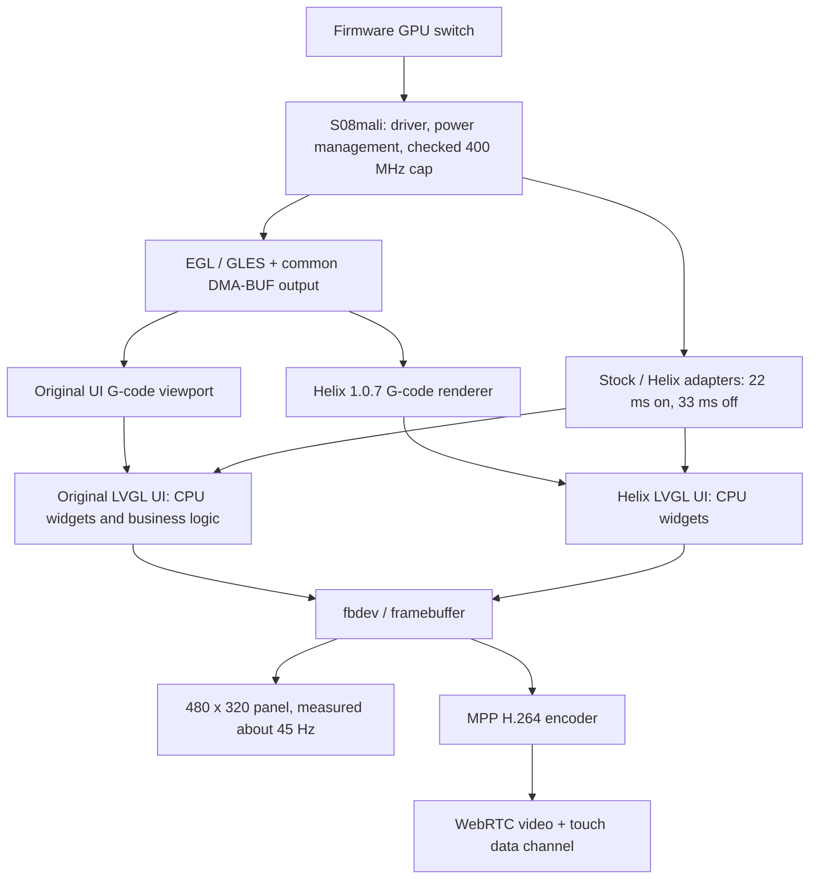

# GPU architecture and UI reconstruction boundary

Updated 2026-10-31. The runtime described here was accepted in stock-ui commit 7ba72da on vendor 2.1.0.157. The branch reorganization changes no installed code. The GPU foundation formerly named gui-gpu is now gpu; the new gui-gpu is an experimental descendant for factory UI rendering and reconstruction feasibility.

## What runs today

gpu owns three bounded parts:

| Part | Responsibility | Boundary |
| --- | --- | --- |
| Hardware/runtime | Existing RK3562 Mali-G52 node, pinned driver and userspace library, runtime suspend, effective policy after checking the 400 MHz cap | No voltage change, panel overclock or additional graphics daemon |
| Shared output | Allocate DMA-BUF, import it into EGL, expose a texture, wait for GPU completion, pair CPU read synchronization and release resources | No page logic, geometry, font layout or printer commands |
| Consumer adapters | Exact-hash factory refresh/measurement adapter; version-matched Helix executable with shared output and bounded geometry | Private factory ABI stays separate from the reusable module |

The implementation remains under overlays/mods/BICHENG/71-ui-gpu. Renaming a Git branch does not rename installed files, configuration keys or service hooks. The existing Firmware switch remains **Firmware → Snapmaker components → Touchscreen GPU acceleration**. It preserves the selected UI and applies by reboot while idle with heater targets at zero.

The output API is deliberately small: create an output, obtain its texture and stride, begin/end a CPU read, then destroy it. The caller owns its EGL context, geometry, orientation and color conversion. Normal output uses DMA-BUF instead of glReadPixels; failed imports retain the existing readback path. GPU completion and CPU cache synchronization are both required. The final copy into LVGL/fbdev still exists, so this is not an end-to-end zero-copy pipeline.

Helix consumes the same source without user renderer adjustments. Its U1 geometry path limits tube sides to four, omits degenerate triangles, writes selection tags in the main pass and checks a combined geometry/GPU memory budget before allocation. An over-budget model retains the existing 2D fallback. Its normal labels, buttons and lists still use CPU rendering.

gui-remote owns framebuffer capture, MPP video encoding, WebRTC and touch lifecycle. MPP is a different hardware block from Mali, so remote operation remains available with GPU disabled. gui-gcode owns parsing, current-layer display, progress, viewport controls and the original UI entry point. These responsibilities do not belong in the common output module.

## What the measurements establish

| Measurement | Accepted result | Interpretation |
| --- | --- | --- |
| Original home page, bounded forced redraw, GPU off/on | 28.3 → 39.1 actual rendered frames/s | Refresh cadence improved about 38%; ordinary widgets did not move to GPU |
| Same 70,370-vertex G-code sample, readback/shared output, ABBA | Mean of run medians 39.31 → 28.69 ms | About 27% lower renderer/delivery time for this sample |
| Helix complex model, shared output | 65.75 ms at 480×320; 46.31 ms at 317×193 | Roughly 15–22 complete redraws/s for this model, not a universal high-frame-rate claim |
| Read-only WebRTC, both switch states | About 45 decoded frames/s, no drops in the measured five-second intervals | Video frame rate differs from newly rendered UI frames |

The panel mode is about 45 Hz. There is no verified 60/120 Hz mode. A 22.2 ms frame budget is the relevant current target; idle screens should stop drawing. No long-print or acoustic acceptance follows from these short measurements.

## Why a GPU switch does not convert every widget

The factory executable contains a statically linked LVGL 9.2-derived implementation and a software draw unit. Loading EGL or changing a display driver does not replace its widget rasterizer. Helix 1.0.7 also keeps CPU widgets in the shipped configuration.

A GPU copy of an already CPU-rendered frame does not remove the CPU drawing work. Conversely, moving each tiny rectangle to GPU and synchronizing after it can cost more. Existing isolated experiments measured a full-screen CPU fill around 0.24 ms versus about 1.18 ms for GPU drawing plus completion on a shared buffer. These are primitive tests, not complete page timings, but they reject a blanket per-widget conversion.

The preferred next investigation belongs in gui-gpu: retain the original application, layouts and event handlers; adapt selected drawing work only where complete-page measurements justify it. Work is still needed for the two main display buffers, DIRECT double-buffer copying, mixed CPU/GPU access, clipping, alpha, production fonts and task lifetimes. The existing shared-output helper alone does not solve these requirements. A task must not be marked complete while the renderer still refers to its descriptor, or left waiting for a flush that itself waits for the task.

## Automatic reconstruction: evidence and limits

Automatic acquisition is feasible. Historical home, files and detail captures already contain object hierarchy, rectangles, text and image references. They also contain hidden or overlapping alternatives without visibility flags. They lack complete styles, font/image bytes, event/state transitions and an embedded firmware hash. They are exploration evidence, not complete or current-version reconstruction fixtures.

Separate isolated probes against the known 2.1 executable verified native drawing-task dispatch with GPU/software fallback and six default-font glyph replay cases. This supports reusing factory layout and drawing information; it does not prove complete control behavior or production-font coverage.

If a separate UI is required, its automation must capture versioned assets and states, generate views, then replay the same inputs and printer-status events through original and generated implementations. Compare images, focus, modal state, navigation and outgoing commands. Unsupported states must remain explicit gaps. Unknown CAN/GPIO behavior cannot be inferred from screenshots or replaced with guessed Moonraker calls. Do not run two independent printer controllers simultaneously.

For a source-owned reconstruction, LVGL's current NanoVG draw unit is a candidate for actual GPU widget rendering. It is not a drop-in library replacement for the statically linked factory LVGL. Its documented stencil/MSAA requirements, layer readback and U1 driver compatibility require a pinned build and measurement. No backend has been selected for production yet. See [LVGL OpenGL overview](https://lvgl.io/docs/open/integration/embedded_linux/opengl) and [NanoVG draw unit](https://lvgl.io/docs/open/integration/embedded_linux/draw_units/draw_nanovg).

## Branch and promotion rules

gpu remains the reusable, accepted foundation. gui-gcode and the experimental gui-gpu follow it; gui-remote remains independent. Routine daily integration is gpu → gui-gcode → gui, plus gui-remote → gui, followed by gui and the other product features → stock-ui.

gui-gpu starts with an evidence-bounded reconstruction plan. No replacement executable, selector or runtime hook is installed by that branch yet. It enters daily integration only after representative pages and state replay show equivalent behavior, repeatable complete-frame gains, correct software fallback, bounded memory and idle resource release. The existing firmware Actions remain sufficient for buildable candidates; a documentation-only branch change needs no firmware build or flash.
