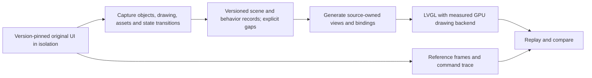

# Factory UI GPU rendering and automated reconstruction

Status on 2026-11-01: measured drawing experiments, based on gpu. This branch contains reproducible diagnostics under [tools/native-ui](../tools/native-ui/README.md) and an optional observation callback in the existing main-loop adapter. The diagnostics are excluded from firmware packaging. There is no replacement UI, additional Firmware selector or installed widget GPU backend. Full automatic reconstruction has not been demonstrated.

The product requirement is the original Snapmaker UX with better drawing performance. Preserve its navigation, layout, printing behavior and settings. Retain the shipped gpu foundation, the original executable and the GPU-off baseline while developing the candidate. See [GPU architecture](gpu-architecture.md) for the accepted runtime and measured limits.

## First route: preserve the application and change drawing

The original application continues to own page construction, layout, events and printer operations. A version-checked adapter consumes native drawing work and uses GPU rendering only for operations with measured complete-page benefit. This applies to all covered pages without manually recreating each one.

The checked GUI SHA256 is 2cf51b704a1d750f269f4132f108197ea7ec3b4b0865b070b87e150bf9d0e472. The current original homepage was captured without changing dispatch or drawing. It contains seven fills, twelve labels and twelve images in one root layer. Correcting the bounded repaint test's second clock produced 45.0 and 45.2 complete frames/s in two five-second windows, with CPU-path refresh p95 of 6.81 and 6.85 ms. These windows exclude the capture overhead and do not measure panel scanout or every page.

The isolated GPU compositor batches the whole scene, imports a 1,920-byte-stride BGRA DMA buffer and finishes once. Framebuffer-fetch shaders reproduce the original integer alpha rules exactly in all fifteen tested default-font scenes; standard GL blending does not. Even after skipping invisible commands and using clears for opaque fills, the 204-glyph scene takes 2.37 ms on GPU versus 1.37 ms through native CPU drawing and delivery. The native measurement includes label layout; GPU atlas preparation is outside its warm timing. This candidate is not promoted.

Eight isolated image/glyph cases also pass resource capture, native passthrough and replay after the source assets are overwritten. Capacity failures still finish native drawing. This proves ownership and selected resource semantics, not a new renderer: replay continues to call the original ELF's CPU drawing functions. Packaged sources reproduce all three measured probe binaries byte-for-byte. See [results and limits](../tools/native-ui/results.json).

The current decision is to retain CPU widgets and the shared GPU path for measured G-code workloads. A future widget backend needs a demonstrated expensive page before further integration. It must include main-buffer allocation, DIRECT synchronization and fbdev delivery in its comparison. Keep the single main-loop adapter. Native task descriptors cannot outlive their LVGL lifetime. Mixed CPU/GPU work must preserve ordering, clipping and alpha with explicit ownership transitions. Neither an extra frame copy nor one synchronization per widget is an assumed performance solution.

Promotion requires complete-frame CPU and GPU measurements on the same page and state, including p95, memory use and idle behavior. A failed performance experiment remains here; it must not add permanent complexity to gpu.

## Fallback: generate the UI from captured behavior

If in-place drawing is not maintainable or does not improve complete-frame time, evaluate a separate generated UI. This is a proposed automated pipeline; its collector, generator and behavior replay have not yet been implemented as a complete system.

### Capture contract

Every capture must record the executable hash, firmware version, language, screen size, input sequence and status-event sequence. Within the scene, capture stable object identity and parentage, class, rectangle, draw order, visibility, state, clipping, computed styles, text, font/glyph data, image contents and transforms. Record assets by content hash, not process pointers. Dynamic values and event transitions need explicit bindings; a button's coordinates do not define its behavior.

The current versioned homepage capture contains a verified frame and 31 task records. Descriptor pointers are diagnostic only. The separately tested resource module is not connected to that capture, so this is not yet a portable whole-page scene. Styles, navigation, event/state transitions and control-command equivalence remain unproven. Memory addresses and class offsets are not stable identities across versions.

Collect additional states through isolated input/status replay with printer commands recorded by test doubles. Do not use an automated click crawler on the production printer. The collector must first prove that the original application cannot reach production control resources; legacy exploratory probes are not production collectors.

### Generation and replay

Generate views from the records instead of manually copying page layouts or drawing screenshots as the UI. Missing properties, unresolved assets and unsupported states must produce a visible coverage gap rather than a guessed default that looks complete. Start with one representative page and its states before generating the rest.

For source-owned views, a pinned LVGL plus NanoVG backend is a candidate for GPU paths, images and text. Its current documented stencil/MSAA requirements and layer readback must be tested on U1. It cannot replace the factory executable's static LVGL by changing a shared library. Preserve the CPU build as the comparison baseline. Backend selection follows measurement, not the presence of an OpenGL context.

Replay the same event stream into the original and generated implementations. Compare frames, hit targets, focus, disabled states, scrolling, modals, navigation and outgoing command traces. Cover file selection, material mapping, print/paused/completed states, settings and errors as observed states are acquired. Do not infer missing behavior from screenshots. Raw Moonraker access alone does not cover the original application's MQTT and incompletely mapped CAN/GPIO paths.

Only one implementation may control the printer. A rendering-only adapter preserves the original controller. A truly independent replacement needs an independently verified protocol/state model before it can own control. Visual similarity alone cannot pass that gate.

## Delivery gates

| Unit | Required evidence | Current status |
| --- | --- | --- |
| Versioned acquisition | Reproducible scene, asset and transition capture; unsupported fields listed | Current homepage metadata/frame capture plus eight isolated resource-replay cases; no whole-page portable scene or transition capture |
| One generated page | Repeatable generator output; state replay and visual/interaction comparison | Not implemented |
| GPU backend | Complete-frame benefit over CPU, correct fallbacks, bounded memory and idle release | Exact pixels in fifteen synthetic scenes; batch compositor slower than CPU and rejected for daily use |
| Whole UI behavior | Coverage inventory with replay for observed states and command equivalence | Not established |
| Daily firmware | Buildable candidate, explicit promotion, rollback and device acceptance | Excluded from gui and stock-ui |

The Native UI diagnostics workflow runs sanitizer tests and target compilation for this branch. The existing Feature firmware workflow remains sufficient for future accepted runtime candidates through workflow_dispatch. Automatic firmware builds exclude gui-gpu while it is research only. The measured diagnostic session restored the shipped libraries and left the printer idle, without touches, motion or heating commands.
