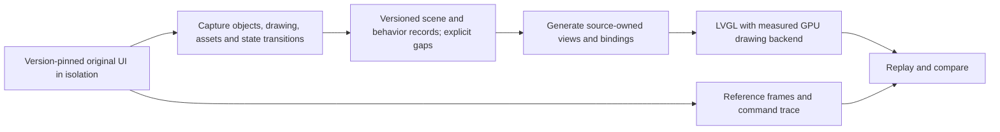

# Factory UI GPU rendering and automated reconstruction

Status on 2026-10-31: feasibility branch, based on gpu. This branch adds this plan only. It does not contain a replacement UI executable, a new runtime hook or a new Firmware selector. Automatic acquisition has supporting evidence; a complete automatic reconstruction has not been demonstrated.

The product requirement is the original Snapmaker UX with better drawing performance. Preserve its navigation, layout, printing behavior and settings. Retain the shipped gpu foundation, the original executable and the GPU-off baseline while developing the candidate. See [GPU architecture](gpu-architecture.md) for the accepted runtime and measured limits.

## First route: preserve the application and change drawing

The original application continues to own page construction, layout, events and printer operations. A version-checked adapter consumes native drawing work and uses GPU rendering only for operations with measured complete-page benefit. This applies to all covered pages without manually recreating each one.

Existing isolated experiments against GUI SHA256 2cf51b704a1d750f269f4132f108197ea7ec3b4b0865b070b87e150bf9d0e472 verified two GPU tasks plus one native software task through the original queue, completion and cleanup. Six default-font cases reproduced copied glyph output without pixel differences. These establish useful entry points, not a complete backend. Simple rectangle fills were slower on GPU, so a blanket replacement is rejected.

The next executable experiment must cover an actual expensive page, including main-buffer allocation, DIRECT double-buffer synchronization and fbdev delivery. Keep the single existing main-loop adapter; do not add a second sleep hook. Native task descriptors cannot outlive their LVGL lifetime. Mixed CPU/GPU work must preserve ordering, clipping and alpha with explicit ownership transitions. Neither an extra frame copy nor one synchronization per widget is an assumed performance solution.

Promotion requires complete-frame CPU and GPU measurements on the same page and state, including p95, memory use and idle behavior. A failed performance experiment remains here; it must not add permanent complexity to gpu.

## Fallback: generate the UI from captured behavior

If in-place drawing is not maintainable or does not improve complete-frame time, evaluate a separate generated UI. This is a proposed automated pipeline; its collector, generator and behavior replay have not yet been implemented as a complete system.

### Capture contract

Every capture must record the executable hash, firmware version, language, screen size, input sequence and status-event sequence. Within the scene, capture stable object identity and parentage, class, rectangle, draw order, visibility, state, clipping, computed styles, text, font/glyph data, image contents and transforms. Record assets by content hash, not process pointers. Dynamic values and event transitions need explicit bindings; a button's coordinates do not define its behavior.

The available historical home/files/detail logs contain 78/684/144 object records respectively. These are record counts, potentially including repeated snapshots, not counts of unique controls or coverage percentages. Their rectangles, text and image references prove that structural extraction is possible. Missing visibility, styles, events and an embedded version hash prevent treating them as current-version golden fixtures. Memory addresses and class offsets are not stable identifiers across versions.

Collect additional states through isolated input/status replay with printer commands recorded by test doubles. Do not use an automated click crawler on the production printer. The collector must first prove that the original application cannot reach production control resources; legacy exploratory probes are not production collectors.

### Generation and replay

Generate views from the records instead of manually copying page layouts or drawing screenshots as the UI. Missing properties, unresolved assets and unsupported states must produce a visible coverage gap rather than a guessed default that looks complete. Start with one representative page and its states before generating the rest.

For source-owned views, a pinned LVGL plus NanoVG backend is a candidate for GPU paths, images and text. Its current documented stencil/MSAA requirements and layer readback must be tested on U1. It cannot replace the factory executable's static LVGL by changing a shared library. Preserve the CPU build as the comparison baseline. Backend selection follows measurement, not the presence of an OpenGL context.

Replay the same event stream into the original and generated implementations. Compare frames, hit targets, focus, disabled states, scrolling, modals, navigation and outgoing command traces. Cover file selection, material mapping, print/paused/completed states, settings and errors as observed states are acquired. Do not infer missing behavior from screenshots. Raw Moonraker access alone does not cover the original application's MQTT and incompletely mapped CAN/GPIO paths.

Only one implementation may control the printer. A rendering-only adapter preserves the original controller. A truly independent replacement needs an independently verified protocol/state model before it can own control. Visual similarity alone cannot pass that gate.

## Delivery gates

| Unit | Required evidence | Current status |
| --- | --- | --- |
| Versioned acquisition | Reproducible scene, asset and transition capture; unsupported fields listed | Partial historical trees and isolated draw/glyph probes only |
| One generated page | Repeatable generator output; state replay and visual/interaction comparison | Not implemented |
| GPU backend | Complete-frame benefit over CPU, correct fallbacks, bounded memory and idle release | Shared GPU output exists; full widget backend not implemented |
| Whole UI behavior | Coverage inventory with replay for observed states and command equivalence | Not established |
| Daily firmware | Buildable candidate, explicit promotion, rollback and device acceptance | Excluded from gui and stock-ui |

The existing Feature firmware workflow can build future candidates through workflow_dispatch. Automatic firmware builds intentionally exclude this documentation-only branch. Add collector/generator checks when executable work exists; do not start a second firmware build system or flash a plan.
